I build production systems where the hard parts are trust boundaries: who can do what, how data is protected, what an LLM may see and spend, and how a change reaches production safely.

---

## What I work on

- **AI engineering:** LLM features with tool calling, structured extraction, versioned prompts, moderation, PII masking, rate limits and cost ceilings.
- **Authentication and authorization:** JWT sessions, invite flows, role and tenant scoping, row-level security, audited admin access.
- **Data protection:** encryption at rest, secrets management, hardened HTTP layers, input validation.
- **Deploy and CI/CD:** GitHub Actions, environment-gated releases, Docker, migrations in the pipeline, smoke tests.
- **Quality gates:** dependency and secret scanning, static analysis, type checks, unit, contract and end-to-end tests.

---

## Toolbox

---

## Open source

**[PulseStream](https://github.com/leozorzii/PulseStream)** - sentiment analysis and trend detection for social media and entertainment content. Django REST Framework, PostgreSQL, Celery, Redis, React.

---

<picture>
  <source media="(prefers-color-scheme: dark)" srcset="https://raw.githubusercontent.com/leozorzii/leozorzii/output/github-snake-dark.svg" />
  <source media="(prefers-color-scheme: light)" srcset="https://raw.githubusercontent.com/leozorzii/leozorzii/output/github-snake.svg" />
  
</picture>

  

